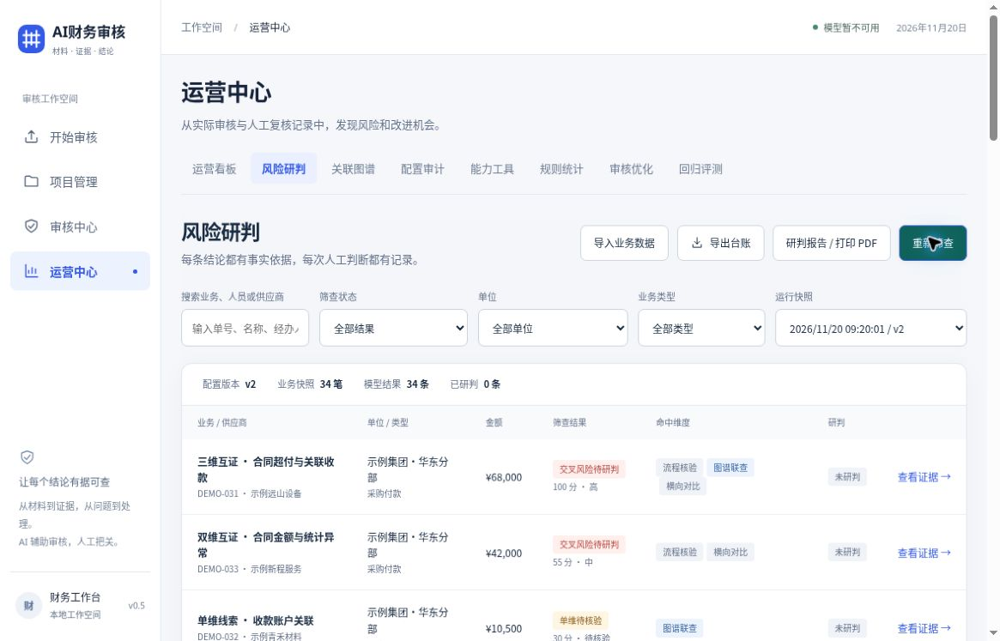

# AI财务审核 · 业财智能合规演示 v0.7

已将原版 v0.4 财务审核源码与风险模型、财务本体配置合并为一个应用。保留“开始审核、项目管理、审核中心、运营中心”四个入口，使用同一个本机服务、会话校验和 SQLite 数据库。



## 本版新增（v0.7）

- **审核中心 → 知识库管理**：按段落或固定长度切片，配置重叠，查看片段与原文位置；BM25、TF-IDF稀疏向量、混合召回及Top K。真实审核引用召回片段并保存快照；自编演示知识不进入真实审核上下文。
- **审核能力**：明确离线模式、CLI存在、登录状态与推理待验证；Jev/StartLux仍是独立可选服务。
- **关联图谱**：供应商定位、节点来源、凭证引用、来源数据JSON导入，以及可一键加载的明确标注演示场景。
- **产品演示**：打开页面右上角“产品演示”，或直接打开 `static/demo.html`。12页实际截图，支持方向键、讲稿N、编辑E、截图放大和离线播放。PDF在 `static/demo.pdf`。

公开仓库与镜像不包含用户原始供应商账户或原材料。含来源记录的本地专用JSON单独交付，请在图谱页导入。当前只提取了1条有材料引用的供应商记录，原金额大小写矛盾，保留为空值；34条补充记录明确标记为演示生成。

## 本地快速启动

需要 **Python 3.11+**。下载仓库 ZIP 后解压到可写目录；首次启动需要联网安装 Python 依赖（含 scikit-learn），之后结构化风险演示可离线运行。

- **Windows**：双击 `start-demo.cmd`（或 `启动系统.cmd`）。首次自动建立 `.venv` 并安装依赖。
- **macOS / Linux**：终端执行 `sh start-demo.sh`。Linux 需要 Python venv 支持。
- 启动后自动打开 `http://127.0.0.1:8765`；保持终端窗口打开，按 Ctrl+C 停止。
- 端口冲突时：`python bootstrap.py --port 8766`。

启动器默认是**离线演示模式**：本体配置、风险计算、图谱、研判、HTML/CSV/JSON 导出均可使用；上传材料仍可治理和提取已有文字，语义审核会明确显示技术未完成。它不会伪造 AI 审核通过。

已有 Python 环境也可以直接运行：

```sh
python -m pip install -r requirements.txt
python launch.py
```

## 风险模型与评测（v0.7 新增）

进入 **运营中心 → 风险模型与评测**。内置稳健统计、跨周期滚动基线、多指标 Isolation Forest 三类可配置模型；配置业务指标、对比群体、历史窗口和灵敏度后保存、发布。

“基线与效果评测”支持历史 JSON 导入、单月检测、最多12个月逐月回测、人工核实标签、版本和数据快照导出。内置1440条虚构历史记录，最后月份为2026-10；示例选择2026-07至2026-10。原审核反馈回归在“审核回归评测”中保留。详细口径见 [统计模型说明](docs/RISK-MODELS.md)。


## 5分钟演示路径

1. **审核中心 → 财务本体**：查看四层实体、属性、关系、业务分类与来源字段映射。新增实体或可选属性，保存草稿。
2. **审核中心 → 交叉核验策略**：调整超付比例、统计阈值、共用账户阈值和权重，检查影响并发布。配置只影响后续筛查。
3. **运营中心 → 风险研判**：点击“重新筛查”。内置34笔虚构业务，展示三维交叉风险、双维风险、单维线索与正常记录。
4. **运营中心 → 关联图谱**：切换账户，查看两跳关系、最短路径和度中心性。共用账户本身不代表违规。
5. **风险研判 → 查看证据**：查看计算依据、填写人工研判、导出台账与研判报告；打印可保存为PDF。

完整讲解步骤见 [演示指南](docs/DEMO-GUIDE.md)，与招标条款的对应及边界见 [需求映射](docs/REQUIREMENTS.md)。

## 从原审核接入风险筛查

上传 `examples/demo-audit-materials.zip` 可演示材料治理和追溯。它只含明确标注为虚构的 HTML 材料。

材料识别后点击“纳入风险筛查”，**人工对照原件**填写业务事实并选择证据页。服务校验原审核编号、证据存在性、字段类型与摘要，保存事实确认人和依据；风险结果可跳回原件页。首次接入需在页面确认替换虚构工作数据，历史运行仍保留。

未知金额、日期、账户和验收事实不会由程序默认补造。当前桥接采用人工确认，尚未实现合同字段的自动高准确率抽取。

也可在风险研判页导入 `examples/business-data.json` 或来源字段映射示例。导入替换当前工作数据，不改变历史结果。

## 启用真实模型审核

原版的65项审核、视觉转写、Harness、人工复核、补证复审与PDF/HTML/JSON不可变报告流程已保留。真实模型审核需要目标电脑安装并登录 **Codex CLI**，具备网络与可用额度；扫描图像的初始OCR使用 Windows OCR 语言包。

复制 `.env.example` 为 `.env`，配置所需项后运行：

```sh
python bootstrap.py --live
```

`--live` 允许原模型链路按配置工作；调用时材料会发送至该电脑所配置的模型服务。Jev / StartLux 属于可选独立复核能力，默认关闭，使用时自行配置端点。源码包不包含旧电脑凭据、模型权重或 Windows 虚拟环境。

PDF 已附文泉驿正黑字体及许可证，减少换机后缺中文字体的问题；也可通过 `AUDIT_PDF_FONT` 指定字体。原Windows PowerShell启动脚本仍保留，采用原配置启动。

## 数据、开发与升级

- `app/`、`server.py`、`static/app.js`：原财务审核主体及集成入口。
- `compliance/`、`static/compliance/`：风险模型、本体、图谱、版本、研判与原证据桥接。
- `data/audit.sqlite3`：原审核对象与合规模块数据；原件、模型缓存、报告也保存在 `data/`。备份时先停止服务，再备份整个目录。
- `tests/`：125项自动化测试，含原68项回归与新增跨模块验证。
- `.devcontainer/`：Python开发环境定义；未创建收费云开发实例。应用仅监听本机，建议本地VS Code容器开发。

```sh
python -m unittest discover -s tests -v
node --check static/app.js
node --check static/compliance/module.js
node --check static/facts.js
python scripts/package_delivery.py
```

升级到本版请使用新目录，先保留旧目录备份。若迁移旧 `data/`，旧记录里的绝对文件路径可能指向原电脑，不能直接承诺跨机可用；可重新上传原始材料并创建新运行。独立扩展 v0.1 的历史数据库不会自动迁移，旧配置与业务可通过JSON导入。

本版是投标演示软件，不等同生产验收：未完成ERP接入、企业SSO/RBAC、图数据库部署、gRPC、自然语言经营查询及生产准确率/性能指标验证。验证细节见 [VALIDATION.md](docs/VALIDATION.md)。
