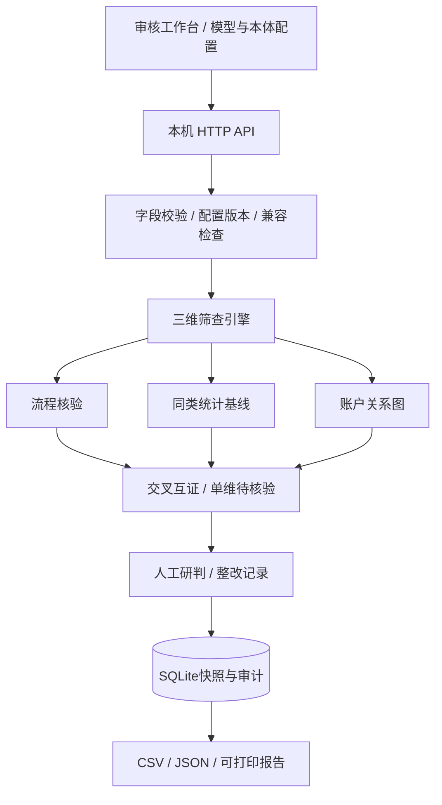

# AI财务审核 · 业财智能合规演示扩展

可在本地离线运行的投标演示模块：**风险模型配置 → 财务本体维护 → 三维筛查 → 证据核对 → 人工研判 → 报告归档**。

> 这是独立扩展，不是原财务审核 v0.4 的完整修改版。收到的源码包实际只包含 PPT 构建文件、启动器和不含应用源码的 Git 对象，缺少 `outputs/financial-audit`。原应用上传、OCR、65 条规则、StartLux、PDF 引擎尚未接入。接入方案见 [INTEGRATION](docs/INTEGRATION.md)。

## 本地启动

需要 **Python 3.10 或以上**，无需安装第三方 Python 包、Node.js、数据库服务或模型，不需要 API Key。

1. 下载仓库 ZIP 或 Release 中的源码启动包，完整解压到一个可写目录。
2. Windows 双击 **`start-demo.cmd`**。macOS / Linux 执行 **`sh start-demo.sh`**。
3. 浏览器自动打开 `http://127.0.0.1:8765`。保持终端窗口运行；停止用 Ctrl+C。
4. 首页点击“执行全量筛查”，开始演示。

也可手动启动：

```bash
python server.py
```

端口被占用时：`python server.py --port 8766`，再打开 `http://127.0.0.1:8766`。

Windows 提示找不到 Python 时，从 python.org 安装 Python 3.10+ 并启用 PATH，或用 `py -3 server.py`。当前验证环境为 Linux / Python 3.12 / Chrome；Windows 和 macOS 启动脚本尚未在对应系统实际验证。

## 已实现的演示能力

| 能力 | 当前实现 |
|---|---|
| 风险模型 | 新增、编辑、启停；5种白名单运算；规则阈值、权重、分级；草稿与发布 |
| 财务本体 | 四层建模；实体和属性维护；新增关系；业务分类；来源字段映射；JSON 导入导出 |
| 版本管理 | 影响分析、兼容检查、不可变发布版本；拒绝删除或改型已发布字段等破坏性变更 |
| 三维互证 | 合同/时序/验收规则；同类金额中位数与MAD；供应商共用账户图谱核验 |
| 风险研判 | 初筛与人工结论分开；单维不直接定性；复核理由必填；确认后整改关闭 |
| 图谱联查 | 两跳邻域可视化、最短路径、度中心性；内存关系图，不是图数据库 |
| 数据导入 | JSON 业务数组、已发布字段映射、类型/日期/重复编号/业务分类校验 |
| 导出 | Excel可读CSV、完整JSON快照、可打印HTML研判报告；浏览器打印为PDF |
| 能力工具 | 本机 HTTP JSON 查询、指标、图谱、路径 API；接口试运行 |
| 可追溯 | SQLite 持久化，业务与配置快照，发布记录，复核历史和操作审计 |

业务数据、配置与审计自动保存在 `.local/demo.sqlite3`，重启保留。停止程序后复制整个 `.local` 文件夹即可备份。演示包不包含本次测试产生的数据库，首次启动为干净数据。

## 建议现场演示（约8分钟）

详见 [演示操作手册](docs/DEMO-GUIDE.md)。初始34笔虚构数据的实际计算结果为：2条交叉风险、2条单维线索、30条未命中；这些数量随数据和配置改变。

1. 介绍上传审核后的结构化业务如何进入本模块。
2. 在财务本体新增“验收记录”实体及可选属性，检查影响并发布。
3. 在风险模型调整阈值，保存并发布；强调旧运行保留原版本。
4. 执行筛查，展示 DEMO-031 的三维证据与 DEMO-032 的单维线索差别。
5. 核对事实、人工确认风险、记录整改关闭；在图谱查看共用账户关联。
6. 导出 CSV 台账、打开研判报告并用浏览器打印保存 PDF。

## 数据和导入

`examples/business-data.json` 为全部虚构业务；`examples/mapped-business-data.json` 使用来源字段别名，可验证发布版映射；`examples/ontology-and-models.json` 为完整初始配置。

必需业务字段：`id`、`name`、`unit`、`business_type`、`supplier`、`bank_account`、`person`、`amount`、`contract_amount`、`contract_date`、`payment_date`、`accepted`、`document`。日期为 `YYYY-MM-DD`，金额为有限非负数，合同金额大于0，验收状态为JSON布尔值。文档编号目前是结构化引用，不提供原件坐标或影像。

每批1—500笔，界面文件上限1.9MB；导入替换当前工作数据集，已有运行不变。先导出当前数据作为备份。所有内置人名、单位、供应商、账户与单据均为虚构。

## 实现结构

```text
static/          原生HTML、CSS、JS界面，无CDN
app/seed.py      虚构业务、默认本体和规则
app/domain.py    校验、风险运算、关系图和最短路径
app/store.py     SQLite事务、版本、快照与审计
app/reports.py   CSV、HTML导出及内容转义
server.py        本机HTTP API与请求保护
launch.py        跨平台启动与浏览器打开
tests/          领域、持久化、API与安全验证
docs/           SDD、接口、演示指南、需求对应和接入说明
```



## 验证和开发环境

```bash
python -m unittest discover -s tests -v
```

31项测试覆盖领域计算、配置兼容、持久化、研判状态、快照隔离、请求安全和导出。浏览器验证记录见 [VALIDATION](docs/VALIDATION.md)。`.devcontainer/devcontainer.json` 提供 Python 3.12 开发环境配置，可用于 VS Code Dev Containers；容器首次创建会运行测试。未创建付费 Codespace 或外部托管站点。

## 当前边界

这是单用户、本机演示。默认仅监听127.0.0.1，API进行Host/Origin/自定义请求头校验，不提供公网访问配置。数据库没有身份认证、行列权限、加密存储或防篡改审计；复核姓名由本机操作者填写。不能直接用于生产或处理真实敏感财务资料。

本版本未实现：原应用上传/OCR/65条规则/StartLux接入，向量RAG，真实图数据库与社区发现，生产模型服务、gRPC、统一认证、灰度回退。自然语言分析与批量提示函也未实现。98%提取准确率、80%查实率及生产性能指标均未测得，不能作为达标证据。完整差距见 [需求对应表](docs/REQUIREMENTS.md)。
