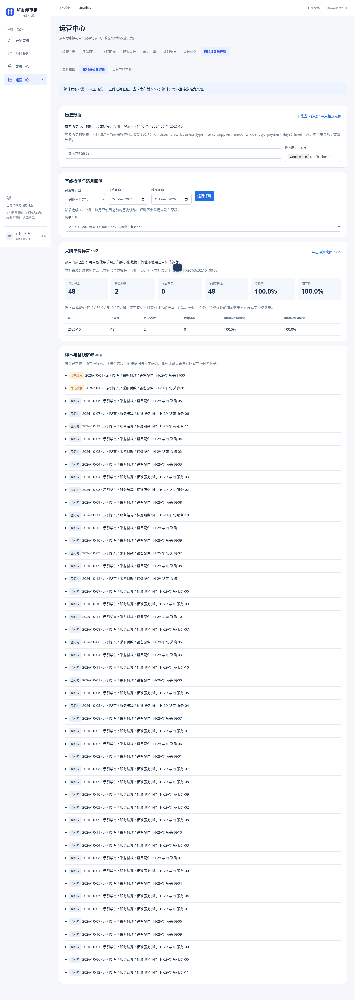

# AI 审核工作台与穿透式监管演示 v0.8

业务经办人用同一入口办理费用、合同和载具审核。监管人员另从付款台账出发，核对业务覆盖，追查跨笔异常，并将核验及整改证据归入同一事项。当前监管样板覆盖一个演示组织和一个季度。合同和载具为可改的虚构示例方案，正式客户标准需由业务方配置。

## 体验 v0.8

| 谁来操作 | 页面与动作 | 可以核实的结果 |
|---|---|---|
| 场景管理员 | 审核中心 → 方案管理，选择合同方案，修改报告标题，保存，用内置样本试跑，填写说明后发布 | 新建项目采用发布版本。已有项目、该项目补证及历史报告保留原有口径 |
| 业务经办人 | 开始审核，首次新建合同项目并选择合同方案，上传 [合同样本](examples/contract-demo.txt)；下次上传沿用项目 | 付款起算条件不同、主体可定位、例外依据需核实。也可新建载具项目上传[载具样本](examples/carrier-demo.txt) |
| 审核人员 | 打开审核，点证据看原文，按项复核，再确认并导出 PDF、HTML 或 JSON；需要补证时从原审核发起 | 一次业务可有多次运行；报告保存当次方案、知识引用、原判和人工意见，Word 材料可按段落、表格行回查 |
| 监管人员 | 监管工作台 → 付款台账 → PAY-002，核对累计和合同条款，发起核查，可从核查单直接发起定向合同审核 | 同合同两笔分别 30,000 与 25,000 元，累计 55,000 元；当时限额 40,000 元，形成 15,000 元待核线索。第二笔尚未送审 |
| 整改与复验岗位 | 监管工作台 → 核查事项，反馈依据，选择排除、退回或转交整改，提交整改材料，由另一人复验 | 原线索及当时条款保留，可以查看历次经办意见和引用的证据 |

监管样例另有 6,000 元待关联付款，季度分母为 3 笔、61,000 元。补充协议在第二笔付款后生效；同名单位、未知验收时间和以后生效的条款都需要单独核实。所有内置监管台账和凭证摘录均为虚构。本机可按模板独立导入台账。

**Mac 升级**请先在旧终端按 Control+C，解压新包，在新包中打开 `更新已有演示-Mac.command` 后选择旧目录。如双击受限，在终端输入 `bash `、将这个文件拖入窗口并回车。完成后沿用原来的 `http://127.0.0.1:8765`。新安装可用 `启动财务审核-Mac.command`，也可从解压目录执行 `sh start-demo.sh`。

**只展示监管汇总**可在解压目录执行 `sh start-demo.sh --summary-only --port 8766`，打开 `http://127.0.0.1:8766`。该监听端口仅返回季度指标，其原件、项目、核查明细和写接口均由服务端拒绝。此模式适用于本机演示。共享电脑上有权操作完整服务或数据库的人员仍可读取业务明细；集团部署需要接入真实身份及组织、事项、字段授权。

## 延续的财务审核能力（v0.7）

- **审核中心 → 知识库管理**：按段落或固定长度切片，配置重叠，查看片段与原文位置；BM25、TF-IDF稀疏向量、混合召回及Top K。真实审核引用召回片段并保存快照；自编演示知识不进入真实审核上下文。
- **审核能力**：明确离线模式、CLI存在、登录状态与推理待验证；Jev/StartLux仍是独立可选服务。
- **关联图谱**：供应商定位、节点来源、凭证引用、来源数据JSON导入，以及可一键加载的明确标注演示场景。
- **产品演示**：打开页面右上角“产品演示”回看 v0.7 财务场景，或直接打开 `static/demo.html`。12页实际截图，支持方向键、讲稿N、编辑E、截图放大和离线播放。PDF在 `static/demo.pdf`。

公开仓库与镜像不包含用户原始供应商账户或原材料。含来源记录的本地专用JSON单独交付，请在图谱页导入。当前只提取了1条有材料引用的供应商记录，原金额大小写矛盾，保留为空值；34条补充记录明确标记为演示生成。

## 本地快速启动

需要 **Python 3.11+**。下载仓库 ZIP 后解压到可写目录；首次启动需要联网安装 Python 依赖（含 scikit-learn），之后结构化风险演示可离线运行。

- **已有 Mac 项目**：先在原启动窗口按 Control+C，在新包中打开 `更新已有演示-Mac.command`，选择旧项目根目录。程序会在原位置更新并启动，保留数据与原始文件路径。
- **Windows**：双击 `start-demo.cmd`（或 `启动系统.cmd`）。首次自动建立 `.venv` 并安装依赖。
- **macOS**：双击 `启动财务审核-Mac.command`，或沿用 `sh start-demo.sh`。启动器会寻找系统命令以及“应用程序”里的 Codex.app。如未找到，会按 Apple 芯片或 Intel 架构从官方 npm 包下载已固定版本的运行程序并校验 SHA-512。首次使用按浏览器提示登录可使用 Codex 的账号。
- **Linux**：终端执行 `sh start-demo.sh`。Linux 需要 Python venv 支持。
- 启动后自动打开 `http://127.0.0.1:8765`；保持终端窗口打开，按 Ctrl+C 停止。
- 端口冲突时：`python bootstrap.py --port 8766`。

启动器默认启用 **Codex AI 审核及原图识别**，使用本机 Codex CLI 的登录和模型配置，需要联网。启动时检查 CLI 和登录状态，检查失败会明确退出，不会静默退回离线模式。Windows 和 Linux 需要机器上已有 Codex 运行程序。Mac 会自动准备。打开“审核中心 → 审核能力 → 测试模型连接”可用随机测试码验证真实推理。显式离线演示可运行 `python3 bootstrap.py --offline`。

视觉识别每批最多 8 页，默认两批并行。每页仍按同一规则采集整图与底部局部图。相同输入会复用本机 `data/audit-cache` 已保存的结果。可在 `.env` 设置 `AUDIT_VISUAL_WORKERS=1` 恢复逐批调用。现场演示已经完成的案例，可以从“项目管理”直接打开对应审核记录，无需重新调用模型。

上传默认沿用上次选择的有效项目（首次优先已有项目）。只有选择“＋ 新建项目”并填写名称才新建；同一项目可有多次审核记录，补证与重新审核保留原项目。旧版离线结果不会自动改写，启用 AI 后在结果页点击“重新识别并审核”。

已有 Python 环境也可以直接运行：

```sh
python -m pip install -r requirements.txt
python launch.py
```

## 风险模型与评测（v0.7 新增）

进入 **运营中心 → 风险模型与评测**。内置稳健统计、跨周期滚动基线、多指标 Isolation Forest 三类可配置模型；配置业务指标、对比群体、历史窗口和灵敏度后保存、发布。

“基线与效果评测”支持历史 JSON 导入、单月检测、最多12个月逐月回测、人工核实标签、版本和数据快照导出。内置1440条虚构历史记录，最后月份为2026-10；示例选择2026-07至2026-10。原审核反馈回归在“审核回归评测”中保留。详细口径见 [统计模型说明](docs/RISK-MODELS.md)。



## 5分钟演示路径

1. **审核中心 → 财务本体**：查看四层实体、属性、关系、业务分类与来源字段映射。新增实体或可选属性，保存草稿。
2. **审核中心 → 交叉核验策略**：调整超付比例、统计阈值、共用账户阈值和权重，检查影响并发布。配置只影响后续筛查。
3. **运营中心 → 风险研判**：点击“重新筛查”。内置34笔虚构业务，展示三维交叉风险、双维风险、单维线索与正常记录。
4. **运营中心 → 关联图谱**：切换账户，查看两跳关系、最短路径和度中心性。共用账户本身不代表违规。
5. **风险研判 → 查看证据**：查看计算依据、填写人工研判、导出台账与研判报告；打印可保存为PDF。

完整讲解步骤见 [演示指南](docs/DEMO-GUIDE.md)，与招标条款的对应及边界见 [需求映射](docs/REQUIREMENTS.md)。

## 从原审核接入风险筛查

上传 `examples/demo-audit-materials.zip` 可演示材料治理和追溯。它只含明确标注为虚构的 HTML 材料。

材料识别后点击“纳入风险筛查”，**人工对照原件**填写业务事实并选择证据页。服务校验原审核编号、证据存在性、字段类型与摘要，保存事实确认人和依据；风险结果可跳回原件页。首次接入需在页面确认替换虚构工作数据，历史运行仍保留。

未知金额、日期、账户和验收事实不会由程序默认补造。当前桥接采用人工确认，尚未实现合同字段的自动高准确率抽取。

也可在风险研判页导入 `examples/business-data.json` 或来源字段映射示例。导入替换当前工作数据，不改变历史结果。

## 启用真实模型审核

原版的65项审核、视觉转写、Harness、人工复核、补证复审与PDF/HTML/JSON不可变报告流程已保留。真实模型审核需要目标电脑安装并登录 **Codex CLI**，具备网络与可用额度；扫描图像的初始OCR使用 Windows OCR 语言包。

复制 `.env.example` 为 `.env`，配置所需项后运行：

```sh
python bootstrap.py --live
```

`--live` 允许原模型链路按配置工作；调用时材料会发送至该电脑所配置的模型服务。Jev / StartLux 属于可选独立复核能力，默认关闭，使用时自行配置端点。源码包不包含旧电脑凭据、模型权重或 Windows 虚拟环境。

PDF 已附文泉驿正黑字体及许可证，减少换机后缺中文字体的问题；也可通过 `AUDIT_PDF_FONT` 指定字体。原Windows PowerShell启动脚本仍保留，采用原配置启动。

## 数据、开发与升级

- `app/`、`server.py`、`static/app.js`：原财务审核主体及集成入口。
- `compliance/`、`static/compliance/`：风险模型、本体、图谱、版本、研判与原证据桥接。
- `data/audit.sqlite3`：原审核对象与合规模块数据；原件、模型缓存、报告也保存在 `data/`。备份时先停止服务，再备份整个目录。
- `tests/`：125项自动化测试，含原68项回归与新增跨模块验证。
- `.devcontainer/`：Python开发环境定义；未创建收费云开发实例。应用仅监听本机，建议本地VS Code容器开发。

```sh
python -m unittest discover -s tests -v
node --check static/app.js
node --check static/compliance/module.js
node --check static/facts.js
python scripts/package_delivery.py
```

升级到本版请使用新目录，先保留旧目录备份。若迁移旧 `data/`，旧记录里的绝对文件路径可能指向原电脑，不能直接承诺跨机可用；可重新上传原始材料并创建新运行。独立扩展 v0.1 的历史数据库不会自动迁移，旧配置与业务可通过JSON导入。

本版是投标演示软件，不等同生产验收：未完成ERP接入、企业SSO/RBAC、图数据库部署、gRPC、自然语言经营查询及生产准确率/性能指标验证。验证细节见 [VALIDATION.md](docs/VALIDATION.md)。
