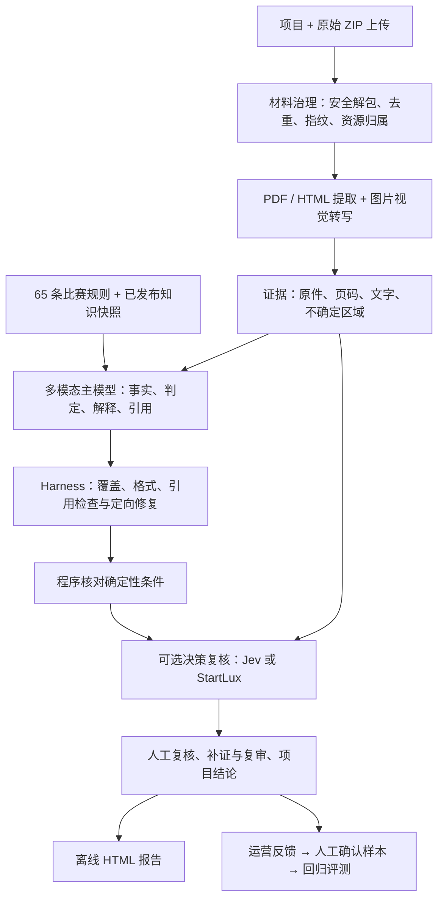

# AI财务审核架构与 Jev / StartLux 接入

2026-10-09更新：本机已部署StartLux-Decision-0.8B-Q8_0-GGUF并真实接入，CPU文字复核、shadow、P0范围。Jev尚未配置。详见《StartLux本机接入记录.md》。以下保留通用架构及两类服务的配置说明。无需Dify。

## 实际架构



前端为 HTML/CSS/JavaScript，后端 Python 本机 HTTP 服务，SQLite 保存项目及不可覆盖的运行版本，单工作线程执行任务。主模型通过现有 Codex CLI 登录调用；图片和文字会发送到对应模型服务，不是全离线推理。上传文档只作为数据，不执行脚本或其中的指令。

**Harness 是应用的执行约束，不是一个替代审核的模型。** 它记录输入指纹、模型运行、规则和知识版本，检查 65 条覆盖、三态枚举、事实/依据、证据引用与缺失说明；只对无效条目进行最多一次修复，技术失败明确留档。程序可计算日期、金额等确定性条件；结构通过不代表业务结论正确。

## 三类模型各自负责什么

| 环节 | 当前实现 | 不能据此宣称 |
|---|---|---|
| 图片识别 | 原图 + 底部水印裁切交给多模态主模型，输出转写及不清区域；保存原始 Windows OCR | 自动转写已经人工确认、100%准确或完成鉴真 |
| 主要审核与对话 | 主模型结合原件、规则与知识生成三态、事实、证据和处理建议 | 仅凭图片判定印章、支付、发票或外部扫码真伪 |
| Jev | 调用官方 SystemOne API，使用引用文字回答两个 Choice 问题 | 本适配器完成了原图识别，或无需 TypeSafe 服务密钥 |
| StartLux-Decision | 调用独立部署的 `/v1/systemone`；可按配置附引用原图 | Choice 输出能直接生成 OCR 转写或完整财务报告 |

StartLux 采用用户指定的 [StartLuxLabs/StartLux-Decision](https://github.com/StartLuxLabs/StartLux-Decision)，不是其他同名 Lux。官方提供 Choice、Noul、Score；本应用选择 Choice，分别询问：引用证据是否支持事实陈述、根据规则应当通过/不通过/待判断。PyTorch 服务可接收图片，GGUF/MLX 文本后端不能按同样方式附图，详见[官方推理说明](https://github.com/StartLuxLabs/StartLux-Decision/blob/main/docs/inference.md)。[Jev API](https://docs.typesafe.ai/api) 同样提供结构化决策接口。

第二层只核对该条引用的材料，不能补出未引用的原件或外部核验信息；仍存在证据选择遗漏和共同误判风险。两个模型的概率不做相乘、平均或多数投票，置信信号也不作为财务准确率。

## 已实现的两种运行模式

- `shadow`：默认对比模式。记录第二层结论、概率、耗时、来源与冲突，保留主审核结果。
- `gate`：显式开启的分流模式。第二层不确定、低置信、矛盾、输入截断或调用失败时，只能把“通过”转成“待人工判断”；不会自动通过任何项目、推翻不通过或清除 P0。

默认 `AUDIT_DECISION_PROVIDER=off`，不产生第二供应商调用，也不显示模拟分数。仅配置完成不等于服务连通；每次运行记录真实调用状态。一次完整复核最多调用 65 次，因此第二层有额外耗时；本机已记录5条P0推理合计247.983秒，见《StartLux本机接入记录》；尚无业务准确率增益数据。

## 如何接入

在项目 `.env` 中设置并重启应用。启动模板是 `.env.example`，密钥只放后端，交付包不包含 `.env`。

Jev：

```ini
AUDIT_DECISION_PROVIDER=jev
AUDIT_DECISION_MODE=shadow
TYPESAFE_API_KEY=填入自己的服务密钥
JEV_MODEL=jev-1.13.0
DECISION_CONFIDENCE=0.8
```

StartLux：本机已经通过安装脚本下载官方0.8B GGUF权重并部署CPU服务，详见《StartLux本机接入记录》。以下4B视觉服务仅作为其他设备的部署配置示例：

```ini
AUDIT_DECISION_PROVIDER=startlux
AUDIT_DECISION_MODE=shadow
STARTLUX_ENDPOINT=http://127.0.0.1:8090/v1/systemone
STARTLUX_MODEL=StartLux-Decision-4B
STARTLUX_IMAGES=on
DECISION_CONFIDENCE=0.8
```

模型名必须等于服务实际响应中的 `model`，上面的 4B 只是配置示例，不是已验证的本机性能选型。仅支持文本的部署将 `STARTLUX_IMAGES=off`；远程部署使用 HTTPS，可通过 `STARTLUX_API_KEY` 配合自己的认证代理。程序拒绝重定向，不向其他服务自动转发材料。

固定模型权重和服务代码版本；变更它们后应更新 `STARTLUX_REVISION` 使缓存失效，并重新评估，即使模型名称没有改变。官方 2026-10-03 更新前后的 confidence 定义有变化，默认 0.8 未做业务标定，不应跨版本直接比较。

## 建议的启用顺序

保持已跑通的主审核，先以 shadow 在人工已确认样本上对比 Jev / StartLux 的误放行、误拦截、转人工占比和延迟；固定版本与阈值后再决定是否开启 gate。当前两份考试包业务内容相同，只能验证包装治理及重复运行，不能用它们独自证明模型泛化或第二层增益。

实现位置：`app/recognition.py`、`app/model.py`、`app/harness.py`、`app/engine.py`、`app/decisions.py`。验收条件先记录于 `REVISION-02.md` 和 `DECISION-SPEC.md`，对应测试为 `test_recognition.py`、`test_decisions.py`。
